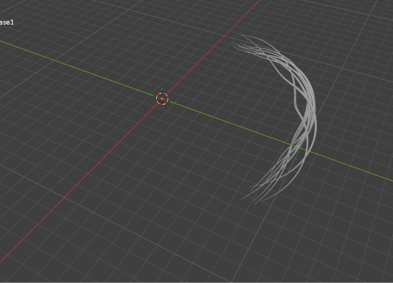
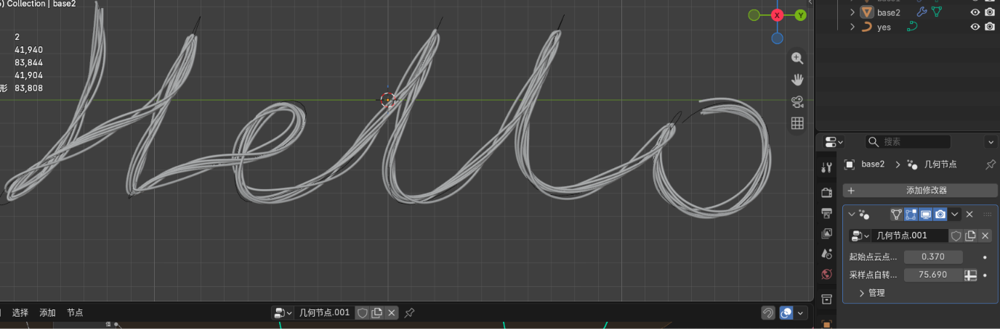

## pointFlow

### base1

- 分布点于体积内,得到点云
- 存储curveId,用于后续点的分组,得到各条曲线
- 点云位置偏移posA,(因为我们要绕中心旋转,先偏移出半径)
- (公转)点云的点绕原点旋转
- (自转)点云绕点云中心点旋转posZ
  - posA需要参与模拟,因为点云的中心位置在变
  - posA-pos原点,得到原点指向点云的矢量
  - 随便选个参考轴,与矢量叉乘,得到点云的切线运动方向dirA
  - 所以最后的旋转(自转)为公转得到的posZ以posA为中心,以dirA为旋转轴进行旋转
- 点转曲线,裁剪balabala....

### base2

